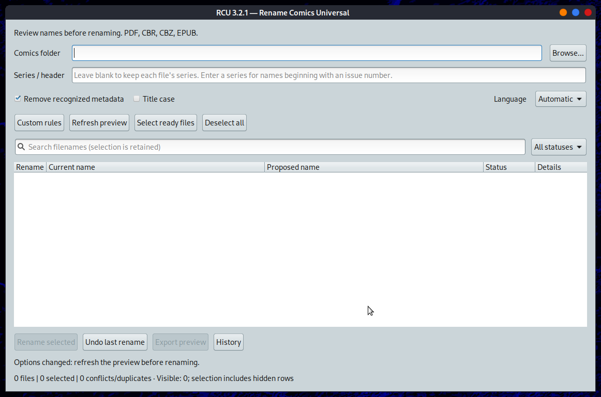
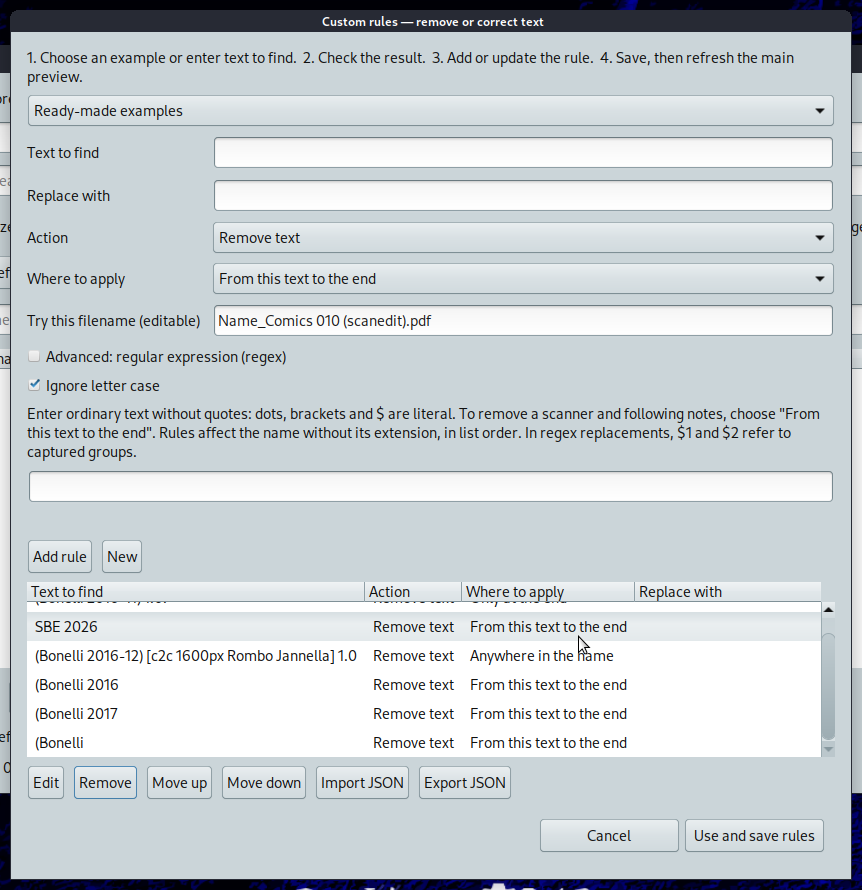

# Rename Comics Converter (RCU) — Linux 3.2.1

[Italiano](#italiano) | [English](#english)

## Download Linux

Download e supporto / Download and support — [Buy Me a Coffee](https://buymeacoffee.com/fconidi/e/487102)


## Italiano

RCU rinomina fumetti PDF, CBR, CBZ ed EPUB su Linux. La versione 3.2.1 offre una
finestra GTK con anteprima, scelta dei file, regole personali e annullamento. Nelle
cartelle miste conserva la serie di ciascun file. L'interfaccia supporta italiano,
inglese, spagnolo, tedesco e francese.

### Schermate della versione 3.2.1

Finestra principale:



Editor delle regole:



### Installazione e avvio

Per installare il pacchetto 3.2.1, nella cartella che contiene il `.deb`:

```bash
sudo apt install ./rename-comics-universal_3.2.1_all.deb
rename_comics_universal --gui
```

Servono Bash e Python 3.9 o successivo. La finestra GTK usa `python3-gi` e
`gir1.2-gtk-3.0`, raccomandati dal pacchetto. Nel menu MATE la voce si chiama
**Rename Comics Converter** ed è in **Graphics**, accanto ad Advanced Comics Converter.
I dialoghi Zenity della versione precedente restano disponibili con `--zenity`.

### Uso

Scegli una cartella, lascia vuota la serie se contiene fumetti diversi, configura
eventuali regole e aggiorna l'anteprima. Controlla i nomi proposti, seleziona i file
e conferma la rinomina. I file esistenti non vengono sovrascritti. La cronologia
permette di annullare le rinomine quando i file non sono stati modificati.

```bash
rename_comics_universal --cli --dry-run ~/Fumetti
rename_comics_universal --cli --history ~/Fumetti
rename_comics_universal --cli --undo ~/Fumetti
```

La 3.2.1 riconosce anche numeri seguiti da virgola, per esempio `Serie 1, Titolo`.
Per rimuovere tutto da `(Bonelli` o `Bonelli` in poi, usa una regola regex con
`\(?Bonelli`, azione **Rimuovi** e ambito **Da questo testo alla fine**.

## English

RCU renames PDF, CBR, CBZ and EPUB comics on Linux. Version 3.2.1 provides a
native GTK window with preview, file selection, custom rules and undo. Mixed
folders retain each file's series. The interface supports English, Italian,
Spanish, German and French. The [main window](screenshots/main-window-3.2.1.png)
and [custom rules editor](screenshots/custom-rules-3.2.1.png) are shown above.

The Linux download is available from [Buy Me a Coffee](https://buymeacoffee.com/fconidi/e/487102).
To install the 3.2.1 package, run APT from the directory containing the `.deb`:

```bash
sudo apt install ./rename-comics-universal_3.2.1_all.deb
rename_comics_universal --gui
```

The package needs Bash and Python 3.9+. It recommends `python3-gi` and
`gir1.2-gtk-3.0` for GTK. MATE lists **Rename Comics Converter** in **Graphics**.
The previous Zenity dialogs remain available with `--zenity`.

Choose a folder, leave the series blank for mixed collections, configure rules,
refresh the preview and review the proposed names before confirming a rename.
Existing files are never overwritten; history supports undo when the renamed
files have not changed. CLI dry runs, history and undo are available with
`--cli --dry-run`, `--cli --history` and `--cli --undo`.

Version 3.2.1 recognizes names such as `Series 1, Title`. To remove everything
from `(Bonelli` or `Bonelli` onward, use regex pattern `\(?Bonelli`, **Remove**
and **From this text to the end**.

## Video Linux

[Video dimostrativo della versione precedente / Previous-version demonstration](https://github.com/user-attachments/assets/6e5d87a3-7b75-423d-adc6-f67b4f0a4c72)

[Guida della versione 2.8.1 / Version 2.8.1 guide](docs/README-2.8.1.md)

## Autore / Author

Franco Conidi aka Edmond — SysLinuxOS.

[Informazioni su RCU](https://francoconidi.it/rcu-rename-comics-universal/) · [francoconidi.it](https://francoconidi.it) · [syslinuxos.com](https://syslinuxos.com)
